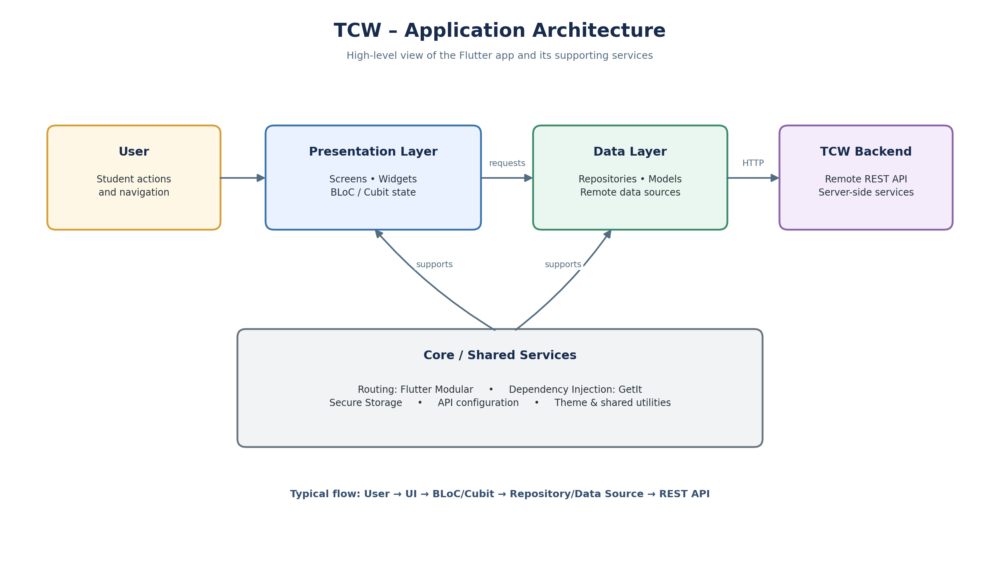
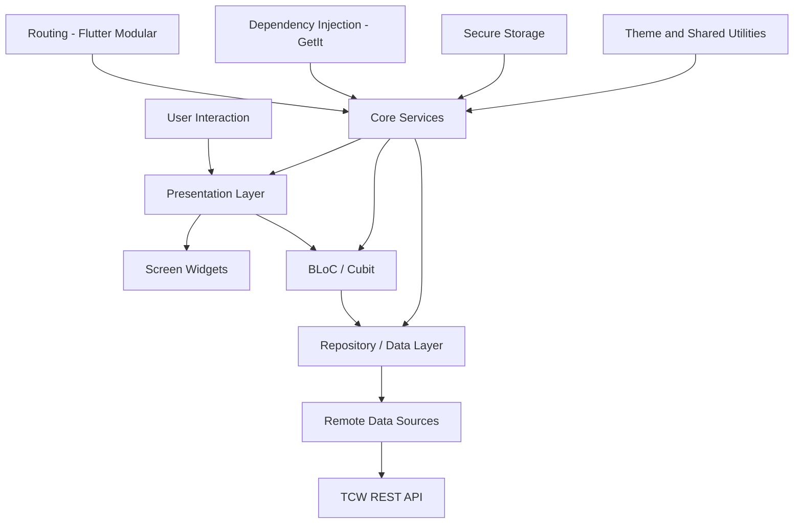
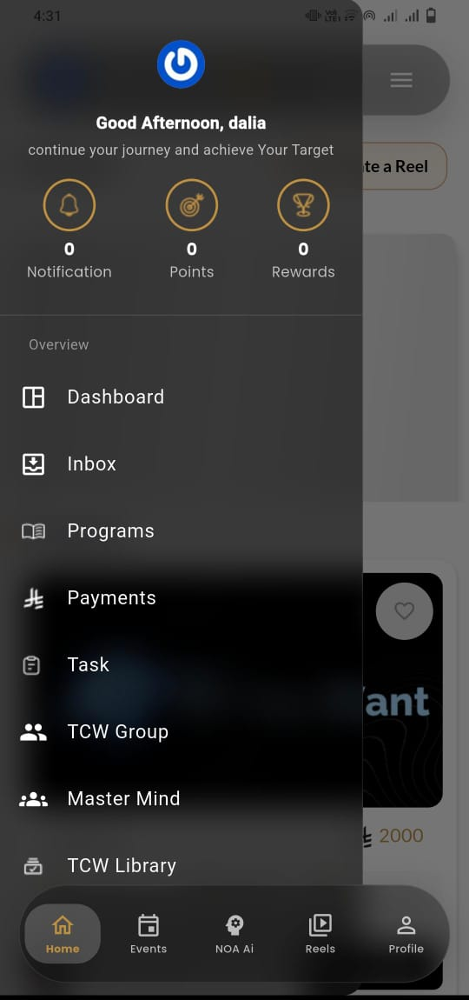
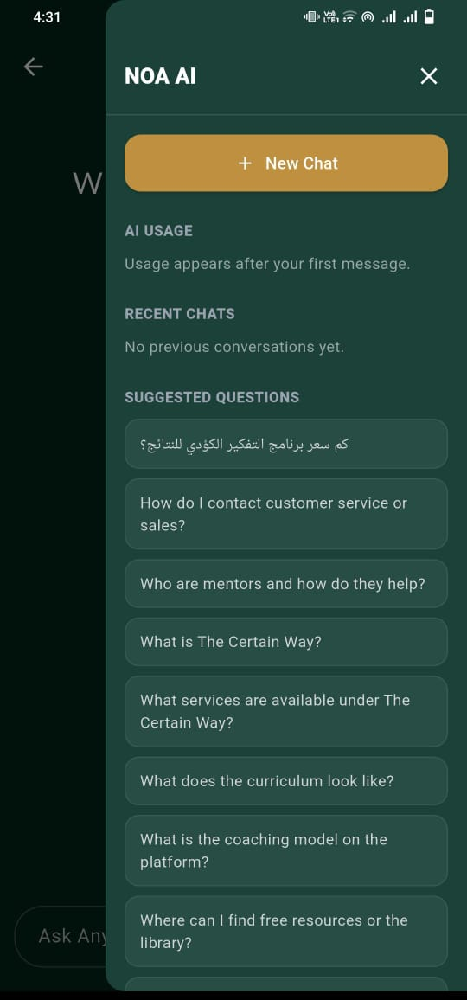
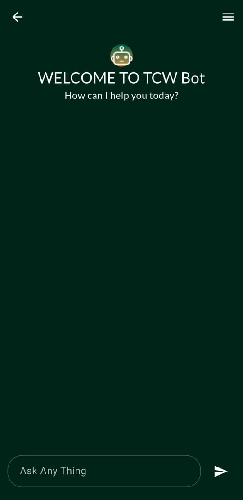
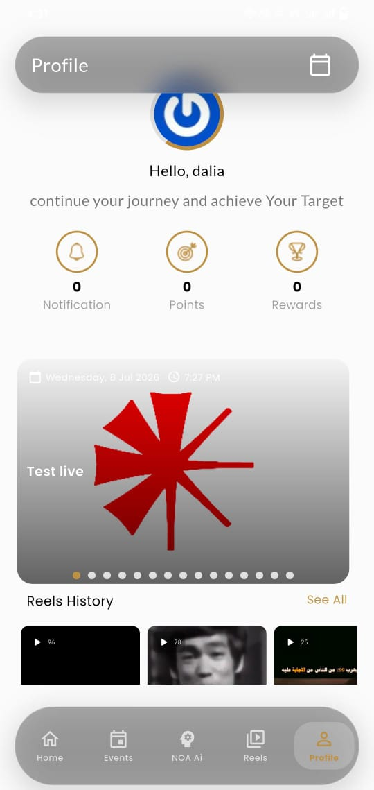
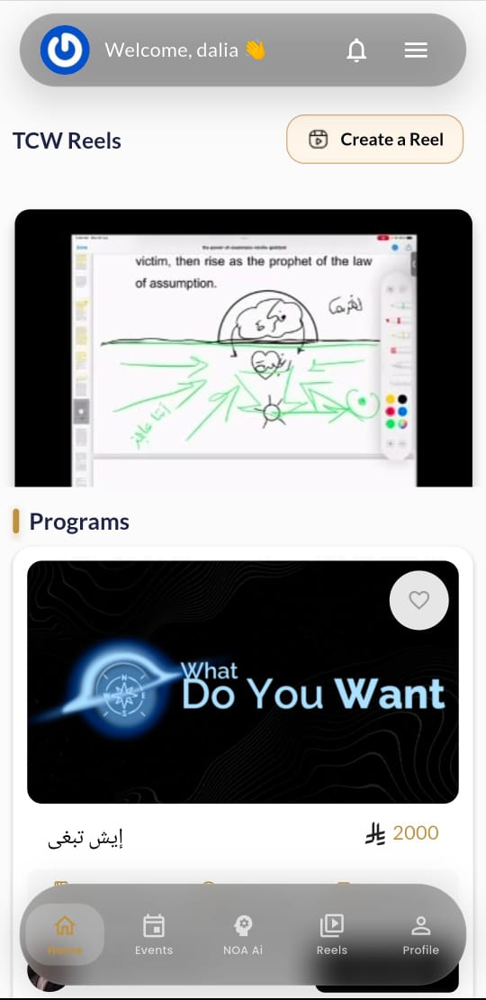
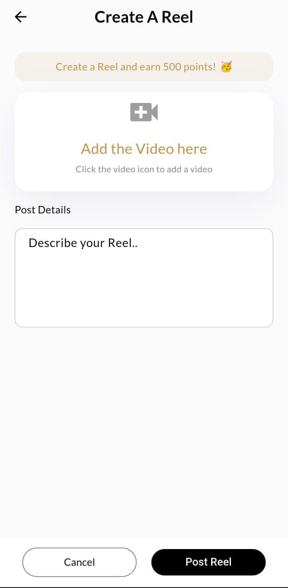
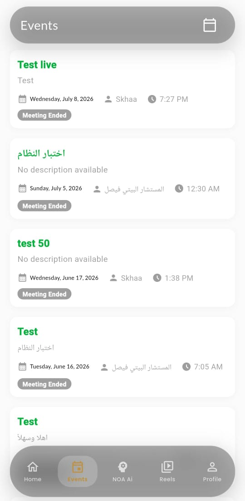

<div align="center">


# My TCW – The  Certain Way

**A Flutter-based student platform for learning, programmes, events, communication, and community activities.**

[](https://play.google.com/store/apps/details?id=com.nixtzone.tcw)

[](https://flutter.dev/)
[](https://dart.dev/)
[](https://bloclibrary.dev/)

</div>

---

## Overview

**TCW** is a student-focused mobile application built with Flutter and Dart. It brings educational content and platform activities together in one app. The application communicates with a remote REST API to support student accounts, courses, learning resources, programmes, events, messaging, notifications, and other student services.

The codebase is organized by feature and separates presentation, data sources, and repositories to support modular development and maintenance.

## Key Features

### Account & Profile
- Student registration and login.
- Forgot-password, OTP verification, and password reset flows.
- Student profile and personal details.
- Secure local storage for saved user information.

### Learning & Courses
- Browse courses and categories.
- View course details and lesson resources.
- Access enrolled courses and learning content.
- Save courses to a wishlist.
- View course tasks and assignment details.
- Explore recommended courses and personal learning library.

### Programmes & Events
- Browse educational programmes and programme details.
- View events, event details, and calendar screens.
- Live-event related screens and event comments.

### Communication & Community
- Student inbox and conversations.
- Send and view chat messages.
- Group chat screens and group creation flow.
- Reels feed and media viewing.
- Create reels, update captions, like content, and comment.
- View reel history.

### Student Services
- Push-notification center.
- Points and rewards screens.
- Account settings and support.
- Payment-related screens and card flow.
- An AI assistant screen is present in the application routes.

### User Experience
- Arabic and English localization.
- Responsive sizing support.
- Custom application theme and Google Fonts.
- Animated bottom navigation and page transitions.
- Video playback and embedded web content support.
- Toast notifications and shared widgets.

> Feature availability may depend on backend services and user account permissions.

## Technology Stack

| Area | Technologies |
|---|---|
| Framework | Flutter |
| Language | Dart |
| State Management | BLoC / Cubit (`flutter_bloc`, `bloc`) |
| Navigation | `flutter_modular` |
| Dependency Management | `get_it` |
| Networking | Dio, HTTP |
| Localization | `easy_localization` |
| Secure Storage | `flutter_secure_storage` |
| Local Preferences | `shared_preferences` |
| Responsive UI | `zap_sizer`, `sizer`, `device_preview` |
| UI & Styling | Material, Google Fonts, Toastification |
| Media | `video_player`, `chewie`, `youtube_player_flutter`, `flutter_inappwebview`, `webview_flutter` |
| Images & Uploads | `cached_network_image`, `image_picker`, `video_thumbnail` |
| Charts | `fl_chart` |
| Device & Permissions | `device_info_plus`, `permission_handler` |
| Utilities | `intl`, `logger`, `flutter_dotenv`, `url_launcher` |

## Architecture

TCW uses a **feature-oriented Flutter architecture**. The application is divided into independent feature modules, while shared services and configuration are kept in the `core/` layer.

At a high level, the app is organized into these responsibilities:

- **Presentation layer:** screens and widgets display the interface. BLoC/Cubit classes manage screen state and react to user actions.
- **Data layer:** models, data sources, and repository implementations handle data retrieval and mapping.
- **Core layer:** shared API configuration, routing, dependency injection, secure storage, theme, utilities, and reusable components.
- **Backend layer:** the remote TCW REST API provides server-side data and operations used by the feature modules.

### Architecture Overview

The diagram below summarizes how the main application layers interact.





**Typical feature flow:** a student interacts with a screen, the related BLoC/Cubit handles the action, and the data layer communicates with the API when remote data is needed. The resulting state is then reflected in the interface. Shared core services support the feature modules.

### Project Structure

The main source folders are organized as follows. Individual feature folders may contain different internal files depending on the feature's needs.


```text
lib/
├── core/
│   ├── apis/           # API service, response handling, endpoint definitions
│   ├── routes/         # Modular routes and dependency bindings
│   ├── shared/         # Shared application widgets
│   ├── storage/        # Secure local storage
│   ├── theme/          # App theme and colors
│   └── utils/          # Shared utilities and asset references
│
├── features/
│   ├── ai/             # AI assistant screen
│   ├── auth/           # Authentication and account flows
│   ├── chat/           # Inbox, conversations, and group chat
│   ├── courses/        # Courses, lessons, wishlist, student learning
│   ├── event/          # Events, calendar, live-event screens
│   ├── home/           # Main application layout
│   ├── notification/   # Student notifications
│   ├── payment/        # Payment and card screens
│   ├── points/         # Points and rewards
│   ├── profile/        # Student profile
│   ├── programmes/     # Educational programmes
│   ├── reels/          # Short videos and interactions
│   ├── setting/        # Settings, personal details, support
│   └── tasks/          # Course tasks and assignments
│
├── init.dart           # Application initialization
└── main.dart           # Application entry point

assets/
├── image/              # Application images and icons
├── lang/               # Localization resources
└── svgs/               # SVG assets
```

## Application Flow

1. Initialize localization and required services.
2. Restore saved student information from secure local storage when available.
3. Open the splash and onboarding flow.
4. Allow students to register, log in, or recover their password.
5. After authentication, provide access to the main application sections.
6. Feature screens request and display data through the remote API.
7. BLoC/Cubit classes manage feature state and update the interface.

## Backend & API Integration

The application uses a REST API hosted by the TCW service. API communication is centralized through shared API service and endpoint classes.

The code includes API integrations for:
- Student authentication and profile.
- Courses, categories, lessons, and assignments.
- Programmes and events.
- Reels and content interactions.
- Notifications.
- Student conversations and messaging.

Authentication-related data is stored locally using `flutter_secure_storage`.

**Configuration note:** The application loads a local `.env` file. Keep private keys, credentials, and environment-specific values out of public commits. Configure required values locally before running the app.

## Getting Started

### Prerequisites

- Flutter SDK.
- Dart SDK compatible with the constraint in `pubspec.yaml` (`^3.5.3`).
- Android Studio or Visual Studio Code.
- An Android emulator, iOS simulator, or physical device.
- Access to the TCW backend services.

### Installation

1. Clone the repository:

   ```bash
   git clone https://github.com/daliamansour11/TCW-app.git
   ```

2. Open the project folder:

   ```bash
   cd TCW-app
   ```

3. Install dependencies:

   ```bash
   flutter pub get
   ```

4. Configure the local `.env` file with the values required by your setup. Do not publish secrets.

5. Run the application:

   ```bash
   flutter run
   ```

### Build

To build an Android APK:

```bash
flutter build apk --release
```

For other supported deployment targets, use the relevant Flutter build command and configure platform-specific requirements.

## Screenshots

The following screenshots show selected screens from the application.

| Home Dashboard | Events | TCW Reels |
|---|---|---|
|  |  |  |

| Navigation Menu | NOA AI Assistant | Create a Reel |
|---|---|---|
|  |  |  |

| Reel Viewer | NOA AI Chat | TCW Brand |
|---|---|---|
|  |  |  |

> Screenshot files are stored in the `screenshots/` folder in this repository.

## Download the App

The TCW Android application is available on Google Play:

[**Download TCW on Google Play**](https://play.google.com/store/apps/details?id=com.nixtzone.tcw)

## Project Status

This repository contains the Flutter application source code and its feature modules. The application integrates with remote TCW backend endpoints.

This README describes functionality and technologies identified in the repository source. It does not claim that every backend-dependent flow, payment operation, or optional service has been tested or is currently available in production.

## Future Improvements

- Add a complete set of current application screenshots.
- Document local environment configuration without exposing secrets.
- Add automated unit and widget tests for core flows.
- Add setup notes for backend-dependent features and deployment.
- Expand documentation for the AI assistant and optional modules as their implementation is finalized.

## Author

**Dalia Mansour**

GitHub: [@daliamansour11](https://github.com/daliamansour11)

---

<div align="center">

**TCW – Learn, connect, and grow.**

</div>
